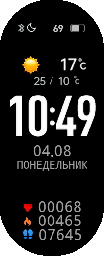
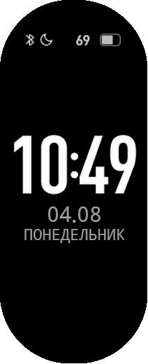
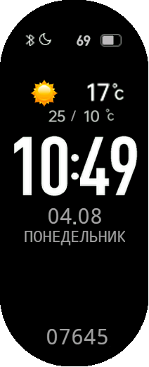

# Xiaomi MiBand 10 Watchface

Циферблат для смарт-часов Xiaomi Smart Band 10.
За основу взят циферблат 26_Simple.v3.face.zip.

|  |  |  |
|:---:|:---:|:---:|
| Сердцебиение, калории, шаги | AOD | Только шаги |

Скачать готовый циферблат можно в разделе [Releases](/releases)

Собрать из исходного проекта можно с помощью WatchfaceCompiler:
```
WatchfaceCompiler.exe build band10 path\to\SimpleNext_v3.1 SimpleNext_v3.1.face
```
